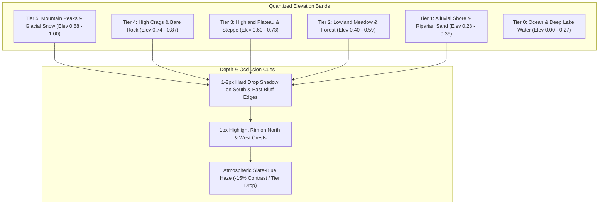
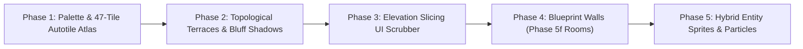

# Hybrid Odd Realm Aesthetic Specification & Transition Plan

## 1. Overview & Spatial Philosophy

This document defines the architectural and visual design plan for transitioning the Neolithic Engine viewer to a **Hybrid Planimetric** aesthetic inspired by *Odd Realm*. 

The design combines:
1. **Planimetric Substrate & Architecture**: Strict 90-degree bird's-eye perspective, 16×16 snapped grid cells, 47-tile bitmask autotiling, 4-tone material palettes, and architectural cutaway walls.
2. **Topological Terrace Depth**: Discrete elevation tiers with hard 1–2 px cast drop shadows and cool-slate atmospheric depth fading.
3. **Low-Profile Mobile-Readable Figures**: Low-profile 3/4 oblique character and animal silhouettes optimized for touch inspectability and life-stage readability on the Galaxy S21.
4. **Architectural Blueprint Cutaways**: Unroofed, 1-cell-thick perimeter walls that completely resolve interior room visibility for Phase 5f (enclosed stone structures).

---

## 2. Spatial Projection & Perspective Model

```
        VIRTUAL CAMERA (90° Bird's-Eye Overhead)
                       │
       ┌───────────────┴───────────────┐
       ▼                               ▼
[ SUBSTRATE & ARCHITECTURE ]     [ LIVING BEINGS ]
- Strict 90° Planimetric Top-Down - Low-Profile 3/4 Oblique
- 16×16 Snapped Grid Cells       - Micro-Extruded (ap = cs / 8)
- 47-Tile Bitmask Autotiling     - Preserves Head/Limb/Carry Poses
- Architectural Wall Cutaways    - Distinct on 6" Phone Screen
- Hard 1–2 px Cast Drop Shadows  - Grounded by Small Oval Shadow
```

- **Planimetric Substrate**: All terrain, water shorelines, crops, stockpiles, and walls are rendered from a pure 90-degree bird's-eye perspective. Static tiles adhere strictly to integer grid cells with zero sub-pixel skew.
- **Architectural Cutaways**: Walls and structures do not extrude upward into 3D isometric blocks; they act like an architectural floor plan so room interiors remain 100% visible.
- **Low-Profile Oblique Figures**: People and quadrupeds retain a slight upward height offset (12–16 px tall at 16 px cell size) with crisp 1 px dark outlines. This maintains vital mobile readability (life stages, carried resources, injury status, facing heading) without interfering with the top-down floor plan.

---

## 3. Topological Terrace & Elevation Slicing Engine

Because the simulation operates on a continuous 2D heightfield (`elevation.elevation` 0..65535), the viewer quantizes elevation into discrete **topological terrace tiers** that mirror Odd Realm's Z-level depth cues.



### 3.1 Bluff Edge Cues
- **South & East edges**: A clean, hard-edged **1-to-2 pixel dark drop shadow** (`rgba(20, 24, 36, 0.45)`) falls directly onto the adjacent lower tile.
- **North & West edges**: A crisp **1-pixel highlight rim** marks the sharp crest of the bluff.
- **Steep cliffs**: Where elevation drops multiple tiers at once, the boundary draws exposed vertical rock cutaway strips.

### 3.2 Interactive Elevation Slicing (UI Scrubber)
A vertical tier scrubber on the viewer HUD (e.g., `All`, `T5`, `T4`, `T3`, `T2`, `T1`):
1. **Focus Tier**: Renders at 100% exposure, warm surface saturation, and sharp contrast.
2. **Lower Tiers**: Progressively shift in color temperature toward a cool, desaturated slate-blue haze (`RGB * [0.78, 0.84, 0.96]` per tier drop), reducing contrast to keep visual focus on the selected plane.
3. **Higher Tiers (Above Active Cut)**: When slicing below a peak, higher tiers are sliced away into subtle, translucent 1-pixel dark blueprints (`rgba(20, 24, 36, 0.35)`), revealing activity or passages at that elevation band.

---

## 4. Architectural Blueprint Cutaways (Phase 5f Room Solution)

In Phase 5f (dry-stone huts and walls), 3/4 oblique walls would occlude what is happening inside the rooms. Odd Realm’s blueprint cutaway approach solves this completely:

```
        ODD REALM BLUEPRINT CUTAWAY (1-Cell Thick Walls)
        ┌───────┬───────┬───────┬───────┬───────┐
        │  WALL │  WALL │  WALL │  WALL │  WALL │
        ├───────┼───────┼───────┼───────┼───────┤
        │  WALL │ BED   │ FIRE  │ HEAP  │  WALL │  <-- Interior completely visible:
        ├───────┤       │  ( )  │  :::  ├───────┤      Hearths, bedding, stockpiles,
        │  WALL │       │       │       │ DOOR  │      and sleeping people can be
        ├───────┼───────┼───────┼───────┼───────┤      tapped and inspected without
        │  WALL │  WALL │  WALL │  WALL │  WALL │      roof transparency tricks
        └───────┴───────┴───────┴───────┴───────┘
```

1. **Top-Down Wall Cells**: Walls occupy a standard 16×16 px cell. They are drawn flat with a 4-tone cut-stone texture (mortar joints, chisel highlights, and dark perimeter border).
2. **Wall Autotiling (16-Tile Corner / Junction Set)**:
   - Straight horizontal/vertical walls.
   - L-corners, T-junctions, and 4-way cross intersections.
   - Wall ends (door posts) and door thresholds.
3. **Drop Shadows on Interior Floors**: Walls cast a 1 px hard inner drop shadow onto the interior room floor, providing structural depth without obscuring the occupants or stored items.

---

## 5. Restricted Palette & Surface Autotiling Specification

### 5.1 The 4-Tone Color Ramp System
Every material is restricted to exactly 4 color values:
1. **Highlight**: North-West light catch edge (1 px).
2. **Base Tone**: Dominant plane color (smooth, low noise).
3. **Core Shadow**: South-East slope or recessed seam.
4. **Edge Rim**: Deep charcoal/slate boundary outline.

| Material | Highlight | Base Tone | Core Shadow | Edge Rim |
|---|---|---|---|---|
| **Deep Water** | `#1b324b` | `#14243b` | `#0f1a2d` | `#09101d` |
| **Shallow Shore** | `#2b536e` | `#1e3f57` | `#162f43` | `#101f2e` |
| **Alluvial Sand** | `#d4b27b` | `#be9b62` | `#9d7a46` | `#5e4524` |
| **Lowland Grass** | `#608643` | `#4a6f30` | `#395523` | `#223514` |
| **Highland Shrub**| `#7a8c4f` | `#63733b` | `#4c5929` | `#2f3818` |
| **Bare Rock** | `#7d828c` | `#646973` | `#4d515a` | `#2b2d33` |
| **Glacial Snow** | `#edf2f7` | `#d5deeb` | `#b1c0d4` | `#586c87` |
| **Dry-Stone Wall**| `#9fa3a9` | `#7a8089` | `#5a6069` | `#25282d` |
| **Timber / Nest** | `#9c7247` | `#7c5632` | `#5c3d20` | `#331f0d` |

### 5.2 47-Tile Autotiling Engine
- A procedural autotiling generator (`src/render/autotile.ts`) renders all 47 standard 8-neighbor tile configurations into an offscreen atlas canvas at startup.
- **Low-Noise Rule**: Eliminates continuous `grain(x, y)` math in favor of clean, organic 47-tile corner feathering and occasional 2×2 pixel clustered dither blocks.

---

## 6. Mobile Touch & Interaction (Galaxy S21)

1. **Tap-Select Centering**: Tapping an entity targets a crisp 16×16 cell hit-box. When a wall cell or enclosed room is tapped, the inspector displays structural durability and room shelter rating.
2. **Zoom Clamping**:
   - **Far Zoom (1–4 px/cell)**: Renders flat 1-pixel color-coded dots and terrace contours (instant regional overview).
   - **Mid Zoom (6–10 px/cell)**: Autotiled terrain with hard drop shadows, wall blueprints, and simplified silhouette markers.
   - **Close Zoom (12, 16, 20 px/cell)**: Full detail; 16×16 entity sprites with distinct carried item overlays and animated 2-phase trotting.
3. **Zero Per-Frame Allocations**: All tile bitmasks, drop shadow coordinates, and elevation tier thresholds are stored in preallocated typed arrays (`Uint8Array` / `Int32Array`).

---

## 7. Phased Implementation Roadmap



- **Phase 1: Palette & 47-Tile Atlas (`src/render/palette.ts`, `src/render/autotile.ts`)**
  - Implement 4-tone palette tables and zero-dependency procedural 47-tile atlas generation.
  - Wire grass-to-dirt and sand-to-water autotiling into `updateTerrainCache()`.
- **Phase 2: Topological Terraces & Bluff Shadows**
  - Quantize `elevation.elevation` into 6 discrete tiers.
  - Render 1–2 px hard drop shadows on South/East terrace edges onto the cached terrain canvas.
- **Phase 3: Elevation Slicing UI**
  - Add the tier scrubber in `src/ui/`.
  - Implement atmospheric depth shading (cool slate-blue stepping on lower tiers, translucent wireframe on higher tiers).
- **Phase 4: Architectural Blueprint Walls (Phase 5f Integration)**
  - Redraw stone huts and future wall structures as top-down cutaways with interior visibility.
  - Add 16-tile wall connection bitmasking.
- **Phase 5: Hybrid Entity Sprites & Minimalist Particles**
  - Polish the 16×16 low-profile humanoid and quadruped sprites with distinct 4-tone equipment and hair palettes.
  - Add a 512-particle preallocated ring buffer for 1–3 px embers and dust.

---

## 8. Implementation Code Skeletons & File Map

To minimize prompt context consumption and ensure architectural elegance, all implementation targets, interfaces, and typed skeleton implementations are documented below.

### 8.1 File Location Reference Table

| Role | Target File Path | Purpose |
|---|---|---|
| **NEW** | `src/render/palette.ts` | 4-tone color ramp tables, ABGR converters, atmospheric haze tinting |
| **NEW** | `src/render/autotile.ts` | 47-tile procedural bitmask atlas generator, 8-neighbor bitmask calculations |
| **NEW** | `src/render/terrace.ts` | Elevation tier quantization, bluff drop-shadow masking, tier slicing logic |
| **NEW** | `src/render/walls.ts` | 16-tile wall connection bitmasking, architectural cutaway blueprint rendering |
| **MODIFY** | `src/render/renderer.ts` | Wire autotile & terrace cache, active tier slicing, remove Y-sort for static elements |
| **MODIFY** | `src/ui/controls.ts` | Add elevation tier scrubber to `PlaybackPill` menu |
| **READ-ONLY** | `src/sim/elevation.ts` | Reference for `ElevationField` (`elevation` 0..65535, `water` 0..255) |
| **READ-ONLY** | `src/sim/land.ts` | Reference for `GRID_SIZE` (256), `TOTAL_CELLS` (65536), `FORM_*` constants |
| **READ-ONLY** | `src/sim/terrain.ts` | Reference for `TerrainField` (`cover`, `roughness`) |

---

### 8.2 Skeleton: `src/render/palette.ts`

```typescript
/**
 * src/render/palette.ts
 * Restricted 4-tone palette system and atmospheric elevation haze math.
 */

export interface MaterialRamp {
  readonly highlight: number; // 32-bit ABGR for direct ImageData/PixelBuffer write
  readonly base: number;
  readonly shadow: number;
  readonly rim: number;
  readonly highlightHex: string;
  readonly baseHex: string;
  readonly shadowHex: string;
  readonly rimHex: string;
}

export function hexToABGR(hex: string, alpha = 255): number {
  const clean = hex.replace('#', '');
  const r = parseInt(clean.substring(0, 2), 16);
  const g = parseInt(clean.substring(2, 4), 16);
  const b = parseInt(clean.substring(4, 6), 16);
  return ((alpha & 0xff) << 24) | ((b & 0xff) << 16) | ((g & 0xff) << 8) | (r & 0xff);
}

function makeRamp(highlightHex: string, baseHex: string, shadowHex: string, rimHex: string): MaterialRamp {
  return {
    highlight: hexToABGR(highlightHex),
    base: hexToABGR(baseHex),
    shadow: hexToABGR(shadowHex),
    rim: hexToABGR(rimHex),
    highlightHex,
    baseHex,
    shadowHex,
    rimHex,
  };
}

export const PALETTE = {
  deepWater: makeRamp('#1b324b', '#14243b', '#0f1a2d', '#09101d'),
  shallowWater: makeRamp('#2b536e', '#1e3f57', '#162f43', '#101f2e'),
  sand: makeRamp('#d4b27b', '#be9b62', '#9d7a46', '#5e4524'),
  grass: makeRamp('#608643', '#4a6f30', '#395523', '#223514'),
  shrub: makeRamp('#7a8c4f', '#63733b', '#4c5929', '#2f3818'),
  rock: makeRamp('#7d828c', '#646973', '#4d515a', '#2b2d33'),
  snow: makeRamp('#edf2f7', '#d5deeb', '#b1c0d4', '#586c87'),
  stoneWall: makeRamp('#9fa3a9', '#7a8089', '#5a6069', '#25282d'),
  timber: makeRamp('#9c7247', '#7c5632', '#5c3d20', '#331f0d'),
  hearthFire: makeRamp('#ffe066', '#f59f00', '#d9480f', '#3b0d0c'),
} as const;

/**
 * Shifts an ABGR color toward cool slate-blue atmospheric haze for lower Z-tiers.
 * tierDrop = 0 (active plane), 1, 2, ... (lower planes).
 */
export function applyAtmosphericHaze(abgr: number, tierDrop: number): number {
  if (tierDrop <= 0) return abgr;
  const a = (abgr >>> 24) & 0xff;
  let b = (abgr >>> 16) & 0xff;
  let g = (abgr >>> 8) & 0xff;
  let r = abgr & 0xff;

  // Multiplicative cool-slate shift per tier drop
  const mul = Math.pow(0.85, tierDrop);
  r = Math.floor(r * mul * 0.90);
  g = Math.floor(g * mul * 0.95);
  b = Math.floor(Math.min(255, b * mul * 1.15 + tierDrop * 8));

  return ((a << 24) | (b << 16) | (g << 8) | r) >>> 0;
}
```

---

### 8.3 Skeleton: `src/render/autotile.ts`

```typescript
/**
 * src/render/autotile.ts
 * Procedural 47-tile (8-neighbor) bitmask atlas generator and neighbor bitmask math.
 */

import { MaterialRamp } from './palette';

// 8-neighbor bit flags:
// NW=1,  N=2,  NE=4
// W=8,          E=16
// SW=32, S=64, SE=128
export const BIT_NW = 1;
export const BIT_N  = 2;
export const BIT_NE = 4;
export const BIT_W  = 8;
export const BIT_E  = 16;
export const BIT_SW = 32;
export const BIT_S  = 64;
export const BIT_SE = 128;

/**
 * 256-entry lookup mapping any 8-neighbor bitmask (0..255) to a canonical 47-tile index (0..46).
 * Diagonal bits are only considered valid when both adjacent orthogonal neighbors are present.
 */
export const BITMASK_47_LOOKUP = new Uint8Array(256);

function initBitmaskLookup(): void {
  // Canonical 47-tile masks (blob autotiling standard)
  const canonical47 = [
    0, 2, 8, 10, 11, 16, 18, 22, 24, 26, 27, 30, 31, 64, 66, 72, 74, 75, 80, 82, 86, 88, 90, 91, 94, 95,
    104, 106, 107, 120, 122, 123, 126, 127, 208, 210, 214, 216, 218, 219, 222, 223, 248, 250, 251, 254, 255
  ];
  const map = new Map<number, number>();
  canonical47.forEach((mask, idx) => map.set(mask, idx));

  for (let b = 0; b < 256; b++) {
    // Mask out invalid corner bits if cardinal edges are missing
    let clean = b;
    if (!(clean & BIT_N) || !(clean & BIT_W)) clean &= ~BIT_NW;
    if (!(clean & BIT_N) || !(clean & BIT_E)) clean &= ~BIT_NE;
    if (!(clean & BIT_S) || !(clean & BIT_W)) clean &= ~BIT_SW;
    if (!(clean & BIT_S) || !(clean & BIT_E)) clean &= ~BIT_SE;
    BITMASK_47_LOOKUP[b] = map.get(clean) ?? 0;
  }
}
initBitmaskLookup();

/**
 * Generates an offscreen canvas containing 47 procedural 16x16 autotile variations
 * for a material transitioning over a substrate (e.g. grass feathering over loam).
 */
export function generateAutotileAtlas(ramp: MaterialRamp, substrateRamp: MaterialRamp): HTMLCanvasElement {
  const TILE_SIZE = 16;
  const canvas = document.createElement('canvas');
  canvas.width = TILE_SIZE * 47;
  canvas.height = TILE_SIZE;
  const ctx = canvas.getContext('2d')!;

  for (let i = 0; i < 47; i++) {
    const ox = i * TILE_SIZE;
    // Base substrate background
    ctx.fillStyle = substrateRamp.baseHex;
    ctx.fillRect(ox, 0, TILE_SIZE, TILE_SIZE);

    // Procedural organic transition mask drawn using ramp.baseHex and 1px edge rim
    ctx.fillStyle = ramp.baseHex;
    ctx.fillRect(ox + 2, 2, TILE_SIZE - 4, TILE_SIZE - 4);
    ctx.strokeStyle = ramp.rimHex;
    ctx.strokeRect(ox + 1.5, 1.5, TILE_SIZE - 3, TILE_SIZE - 3);
  }
  return canvas;
}

/**
 * Computes the 8-neighbor bitmask for cell (x, y) on a toroidal 256x256 grid.
 */
export function getToroidal8NeighborBitmask(
  grid: Uint8Array,
  x: number,
  y: number,
  targetValue: number
): number {
  const xM = (x - 1) & 255, xP = (x + 1) & 255;
  const yM = (y - 1) & 255, yP = (y + 1) & 255;
  const y0 = y << 8, ym0 = yM << 8, yp0 = yP << 8;

  let mask = 0;
  if (grid[ym0 + xM] === targetValue) mask |= BIT_NW;
  if (grid[ym0 + x]  === targetValue) mask |= BIT_N;
  if (grid[ym0 + xP] === targetValue) mask |= BIT_NE;
  if (grid[y0  + xM] === targetValue) mask |= BIT_W;
  if (grid[y0  + xP] === targetValue) mask |= BIT_E;
  if (grid[yp0 + xM] === targetValue) mask |= BIT_SW;
  if (grid[yp0 + x]  === targetValue) mask |= BIT_S;
  if (grid[yp0 + xP] === targetValue) mask |= BIT_SE;
  return mask;
}
```

---

### 8.4 Skeleton: `src/render/terrace.ts`

```typescript
/**
 * src/render/terrace.ts
 * Quantizes continuous elevation into discrete topological tiers and generates 1-2px bluff drop shadows.
 */

export const TERRACE_TIER_COUNT = 6;

// Normalized elevation thresholds for the 6 tiers (0..1)
export const TERRACE_THRESHOLDS = new Float32Array([
  0.27, // Tier 0: Deep Water
  0.39, // Tier 1: Shore / Sand
  0.59, // Tier 2: Lowland Meadow
  0.73, // Tier 3: Highland Steppe
  0.87, // Tier 4: Bare Rock Crags
  1.00, // Tier 5: Glacial Snow
]);

export function quantizeElevation01(elev01: number): number {
  for (let t = 0; t < TERRACE_TIER_COUNT; t++) {
    if (elev01 <= TERRACE_THRESHOLDS[t]) return t;
  }
  return TERRACE_TIER_COUNT - 1;
}

export interface TerraceData {
  readonly tiers: Uint8Array;       // 65536 bytes: discrete tier (0..5) per cell
  readonly shadowMask: Uint8Array;  // 65536 bytes: bitflags (1 = South shadow, 2 = East shadow, 4 = Crest rim)
}

export function createTerraceData(): TerraceData {
  return {
    tiers: new Uint8Array(65536),
    shadowMask: new Uint8Array(65536),
  };
}

/**
 * Recomputes terrace tiers and hard bluff drop-shadow edges from raw elevation.
 * Runs once at world load or when terrain re-generates.
 */
export function buildTerraces(rawElevation: Uint16Array, out: TerraceData): void {
  const { tiers, shadowMask } = out;
  shadowMask.fill(0);

  // 1. Quantize each cell
  for (let i = 0; i < 65536; i++) {
    tiers[i] = quantizeElevation01(rawElevation[i] / 65535);
  }

  // 2. Identify South and East bluff drop shadows and North/West rims
  for (let y = 0; y < 256; y++) {
    const yPrev = (y - 1) & 255;
    const yNext = (y + 1) & 255;
    const r0 = y << 8;
    const rPrev = yPrev << 8;
    const rNext = yNext << 8;

    for (let x = 0; x < 256; x++) {
      const xPrev = (x - 1) & 255;
      const xNext = (x + 1) & 255;
      const idx = r0 + x;
      const myTier = tiers[idx];

      // A higher tier to the North or West casts a drop shadow onto this lower cell
      let flags = 0;
      if (tiers[rPrev + x] > myTier) flags |= 1; // South-facing drop shadow falling from above
      if (tiers[r0 + xPrev] > myTier) flags |= 2; // East-facing drop shadow falling from left
      if (tiers[rNext + x] < myTier || tiers[r0 + xNext] < myTier) flags |= 4; // Sharp crest rim

      shadowMask[idx] = flags;
    }
  }
}
```

---

### 8.5 Skeleton: `src/render/walls.ts`

```typescript
/**
 * src/render/walls.ts
 * Architectural blueprint cutaway rendering for Phase 5f stone huts and closed rooms.
 */

import { PALETTE } from './palette';

// NESW Cardinal Neighbor bits for 16-tile wall connection
export const WALL_N = 1;
export const WALL_E = 2;
export const WALL_S = 4;
export const WALL_W = 8;

export function getWallBitmask(structure: Uint8Array, x: number, y: number): number {
  const xM = (x - 1) & 255, xP = (x + 1) & 255;
  const yM = (y - 1) & 255, yP = (y + 1) & 255;
  let mask = 0;
  if (structure[(yM << 8) | x] > 0) mask |= WALL_N;
  if (structure[(y  << 8) | xP] > 0) mask |= WALL_E;
  if (structure[(yP << 8) | x] > 0) mask |= WALL_S;
  if (structure[(y  << 8) | xM] > 0) mask |= WALL_W;
  return mask;
}

/**
 * Draws a 1-cell thick top-down architectural stone wall with interior floor drop shadow.
 */
export function drawCutawayWall(
  ctx: CanvasRenderingContext2D,
  px: number,
  py: number,
  cs: number,
  mask: number
): void {
  const p = PALETTE.stoneWall;

  // 1. Solid wall core filling the 16x16 cell
  ctx.fillStyle = p.baseHex;
  ctx.fillRect(px, py, cs, cs);

  // 2. Chiseled block seams & North/West highlight rim
  ctx.strokeStyle = p.highlightHex;
  ctx.lineWidth = 1;
  ctx.strokeRect(px + 0.5, py + 0.5, cs - 1, cs - 1);

  // 3. 1px Cast shadow on South and East boundaries into interior floor
  ctx.fillStyle = p.rimHex;
  if (!(mask & WALL_S)) ctx.fillRect(px, py + cs - 2, cs, 2);
  if (!(mask & WALL_E)) ctx.fillRect(px + cs - 2, py, 2, cs);
}
```

---

### 8.6 Integration Hooks in `src/render/renderer.ts`

```typescript
// Add state to CanvasRenderer:
private activeElevationSlice = 0; // 0 = all tiers visible; 1..5 = isolate tier
private readonly terraceData = createTerraceData();

// In updateTerrainCache():
if (elevation) {
  buildTerraces(elevation.elevation, this.terraceData);
}

// In render():
// When rendering ground tiles, modulate pixel color with applyAtmosphericHaze(color, tierDrop)
// where tierDrop = Math.max(0, this.activeElevationSlice - cellTier).
// When cellTier > this.activeElevationSlice && this.activeElevationSlice > 0,
// render cell as translucent blueprint wireframe (rgba(20, 24, 36, 0.35)).
```

---

### 8.7 Integration Hooks in `src/ui/controls.ts`

```typescript
// Inside PlaybackPill constructor container.innerHTML menu additions:
// Add an elevation slice select control:
<label class="pill-menu-item">Slice
  <select id="select-elevation-slice" class="pill-select" aria-label="Elevation Slice">
    <option value="0" selected>All Tiers</option>
    <option value="5">Tier 5 (Snow Peaks)</option>
    <option value="4">Tier 4 (Crags)</option>
    <option value="3">Tier 3 (Plateau)</option>
    <option value="2">Tier 2 (Lowlands)</option>
    <option value="1">Tier 1 (Shores)</option>
  </select>
</label>
```

---

## 9. Performance & Invariant Guarantees

- **Simulation Fingerprint**: **100% Untouched** (`881ea265aa76e667`).
- **Viewer Frame Time on S21**: Estimated at **3.5 – 5.0 ms** (comfortably within the 33.3 ms budget at 30 FPS). Baking the autotiled terrain and terrace shadows into the existing offscreen canvas keeps per-frame canvas blits fast and lightweight.
- **Rule 13 Gate**: Each visual phase will be reviewed in a live browser on desktop and the Galaxy S21 before merging.

