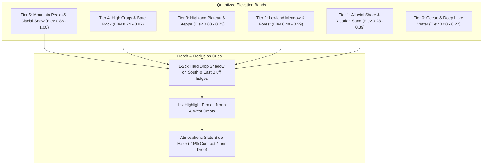
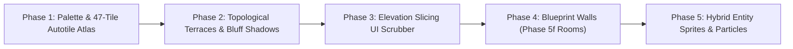

# Hybrid Odd Realm Aesthetic Specification & Transition Plan

## 1. Overview & Spatial Philosophy

This document defines the architectural and visual design plan for transitioning the Neolithic Engine viewer to a **Hybrid Planimetric** aesthetic inspired by *Odd Realm*. 

The design combines:
1. **Planimetric Substrate & Architecture**: Strict 90-degree bird's-eye perspective, 16×16 snapped grid cells, 47-tile bitmask autotiling, 4-tone material palettes, and architectural cutaway walls.
2. **Topological Terrace Depth**: Discrete elevation tiers with hard 1–2 px cast drop shadows and cool-slate atmospheric depth fading.
3. **Low-Profile Mobile-Readable Figures**: Low-profile 3/4 oblique character and animal silhouettes optimized for touch inspectability and life-stage readability on the Galaxy S21.
4. **Architectural Blueprint Cutaways**: Unroofed, 1-cell-thick perimeter walls that completely resolve interior room visibility for Phase 5f (enclosed stone structures).

---

## 2. Spatial Projection & Perspective Model

```
        VIRTUAL CAMERA (90° Bird's-Eye Overhead)
                       │
       ┌───────────────┴───────────────┐
       ▼                               ▼
[ SUBSTRATE & ARCHITECTURE ]     [ LIVING BEINGS ]
- Strict 90° Planimetric Top-Down - Low-Profile 3/4 Oblique
- 16×16 Snapped Grid Cells       - Micro-Extruded (ap = cs / 8)
- 47-Tile Bitmask Autotiling     - Preserves Head/Limb/Carry Poses
- Architectural Wall Cutaways    - Distinct on 6" Phone Screen
- Hard 1–2 px Cast Drop Shadows  - Grounded by Small Oval Shadow
```

- **Planimetric Substrate**: All terrain, water shorelines, crops, stockpiles, and walls are rendered from a pure 90-degree bird's-eye perspective. Static tiles adhere strictly to integer grid cells with zero sub-pixel skew.
- **Architectural Cutaways**: Walls and structures do not extrude upward into 3D isometric blocks; they act like an architectural floor plan so room interiors remain 100% visible.
- **Low-Profile Oblique Figures**: People and quadrupeds retain a slight upward height offset (12–16 px tall at 16 px cell size) with crisp 1 px dark outlines. This maintains vital mobile readability (life stages, carried resources, injury status, facing heading) without interfering with the top-down floor plan.

---

## 3. Topological Terrace & Elevation Slicing Engine

Because the simulation operates on a continuous 2D heightfield (`elevation.elevation` 0..65535), the viewer quantizes elevation into discrete **topological terrace tiers** that mirror Odd Realm's Z-level depth cues.



### 3.1 Bluff Edge Cues
- **South & East edges**: A clean, hard-edged **1-to-2 pixel dark drop shadow** (`rgba(20, 24, 36, 0.45)`) falls directly onto the adjacent lower tile.
- **North & West edges**: A crisp **1-pixel highlight rim** marks the sharp crest of the bluff.
- **Steep cliffs**: Where elevation drops multiple tiers at once, the boundary draws exposed vertical rock cutaway strips.

### 3.2 Interactive Elevation Slicing (UI Scrubber)
A vertical tier scrubber on the viewer HUD (e.g., `All`, `T5`, `T4`, `T3`, `T2`, `T1`):
1. **Focus Tier**: Renders at 100% exposure, warm surface saturation, and sharp contrast.
2. **Lower Tiers**: Progressively shift in color temperature toward a cool, desaturated slate-blue haze (`RGB * [0.78, 0.84, 0.96]` per tier drop), reducing contrast to keep visual focus on the selected plane.
3. **Higher Tiers (Above Active Cut)**: When slicing below a peak, higher tiers are sliced away into subtle, translucent 1-pixel dark blueprints (`rgba(20, 24, 36, 0.35)`), revealing activity or passages at that elevation band.

---

## 4. Architectural Blueprint Cutaways (Phase 5f Room Solution)

In Phase 5f (dry-stone huts and walls), 3/4 oblique walls would occlude what is happening inside the rooms. Odd Realm’s blueprint cutaway approach solves this completely:

```
        ODD REALM BLUEPRINT CUTAWAY (1-Cell Thick Walls)
        ┌───────┬───────┬───────┬───────┬───────┐
        │  WALL │  WALL │  WALL │  WALL │  WALL │
        ├───────┼───────┼───────┼───────┼───────┤
        │  WALL │ BED   │ FIRE  │ HEAP  │  WALL │  <-- Interior completely visible:
        ├───────┤       │  ( )  │  :::  ├───────┤      Hearths, bedding, stockpiles,
        │  WALL │       │       │       │ DOOR  │      and sleeping people can be
        ├───────┼───────┼───────┼───────┼───────┤      tapped and inspected without
        │  WALL │  WALL │  WALL │  WALL │  WALL │      roof transparency tricks
        └───────┴───────┴───────┴───────┴───────┘
```

1. **Top-Down Wall Cells**: Walls occupy a standard 16×16 px cell. They are drawn flat with a 4-tone cut-stone texture (mortar joints, chisel highlights, and dark perimeter border).
2. **Wall Autotiling (16-Tile Corner / Junction Set)**:
   - Straight horizontal/vertical walls.
   - L-corners, T-junctions, and 4-way cross intersections.
   - Wall ends (door posts) and door thresholds.
3. **Drop Shadows on Interior Floors**: Walls cast a 1 px hard inner drop shadow onto the interior room floor, providing structural depth without obscuring the occupants or stored items.

---

## 5. Restricted Palette & Surface Autotiling Specification

### 5.1 The 4-Tone Color Ramp System
Every material is restricted to exactly 4 color values:
1. **Highlight**: North-West light catch edge (1 px).
2. **Base Tone**: Dominant plane color (smooth, low noise).
3. **Core Shadow**: South-East slope or recessed seam.
4. **Edge Rim**: Deep charcoal/slate boundary outline.

| Material | Highlight | Base Tone | Core Shadow | Edge Rim |
|---|---|---|---|---|
| **Deep Water** | `#1b324b` | `#14243b` | `#0f1a2d` | `#09101d` |
| **Shallow Shore** | `#2b536e` | `#1e3f57` | `#162f43` | `#101f2e` |
| **Alluvial Sand** | `#d4b27b` | `#be9b62` | `#9d7a46` | `#5e4524` |
| **Lowland Grass** | `#608643` | `#4a6f30` | `#395523` | `#223514` |
| **Highland Shrub**| `#7a8c4f` | `#63733b` | `#4c5929` | `#2f3818` |
| **Bare Rock** | `#7d828c` | `#646973` | `#4d515a` | `#2b2d33` |
| **Glacial Snow** | `#edf2f7` | `#d5deeb` | `#b1c0d4` | `#586c87` |
| **Dry-Stone Wall**| `#9fa3a9` | `#7a8089` | `#5a6069` | `#25282d` |
| **Timber / Nest** | `#9c7247` | `#7c5632` | `#5c3d20` | `#331f0d` |

### 5.2 47-Tile Autotiling Engine
- A procedural autotiling generator (`src/render/autotile.ts`) renders all 47 standard 8-neighbor tile configurations into an offscreen atlas canvas at startup.
- **Low-Noise Rule**: Eliminates continuous `grain(x, y)` math in favor of clean, organic 47-tile corner feathering and occasional 2×2 pixel clustered dither blocks.

---

## 6. Mobile Touch & Interaction (Galaxy S21)

1. **Tap-Select Centering**: Tapping an entity targets a crisp 16×16 cell hit-box. When a wall cell or enclosed room is tapped, the inspector displays structural durability and room shelter rating.
2. **Zoom Clamping**:
   - **Far Zoom (1–4 px/cell)**: Renders flat 1-pixel color-coded dots and terrace contours (instant regional overview).
   - **Mid Zoom (6–10 px/cell)**: Autotiled terrain with hard drop shadows, wall blueprints, and simplified silhouette markers.
   - **Close Zoom (12, 16, 20 px/cell)**: Full detail; 16×16 entity sprites with distinct carried item overlays and animated 2-phase trotting.
3. **Zero Per-Frame Allocations**: All tile bitmasks, drop shadow coordinates, and elevation tier thresholds are stored in preallocated typed arrays (`Uint8Array` / `Int32Array`).

---

## 7. Phased Implementation Roadmap



- **Phase 1: Palette & 47-Tile Atlas (`src/render/palette.ts`, `src/render/autotile.ts`)**
  - Implement 4-tone palette tables and zero-dependency procedural 47-tile atlas generation.
  - Wire grass-to-dirt and sand-to-water autotiling into `updateTerrainCache()`.
- **Phase 2: Topological Terraces & Bluff Shadows**
  - Quantize `elevation.elevation` into 6 discrete tiers.
  - Render 1–2 px hard drop shadows on South/East terrace edges onto the cached terrain canvas.
- **Phase 3: Elevation Slicing UI**
  - Add the tier scrubber in `src/ui/`.
  - Implement atmospheric depth shading (cool slate-blue stepping on lower tiers, translucent wireframe on higher tiers).
- **Phase 4: Architectural Blueprint Walls (Phase 5f Integration)**
  - Redraw stone huts and future wall structures as top-down cutaways with interior visibility.
  - Add 16-tile wall connection bitmasking.
- **Phase 5: Hybrid Entity Sprites & Minimalist Particles**
  - Polish the 16×16 low-profile humanoid and quadruped sprites with distinct 4-tone equipment and hair palettes.
  - Add a 512-particle preallocated ring buffer for 1–3 px embers and dust.

---

## 8. Performance & Invariant Guarantees

- **Simulation Fingerprint**: **100% Untouched** (`881ea265aa76e667`).
- **Viewer Frame Time on S21**: Estimated at **3.5 – 5.0 ms** (comfortably within the 33.3 ms budget at 30 FPS). Baking the autotiled terrain and terrace shadows into the existing offscreen canvas keeps per-frame canvas blits fast and lightweight.
- **Rule 13 Gate**: Each visual phase will be reviewed in a live browser on desktop and the Galaxy S21 before merging.
